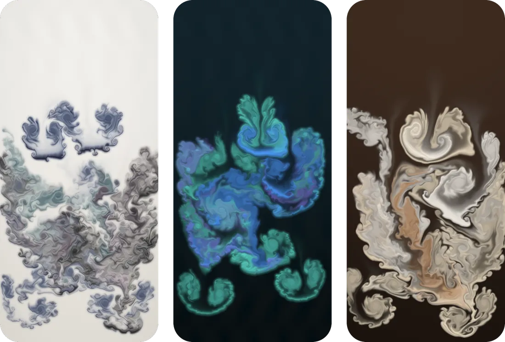
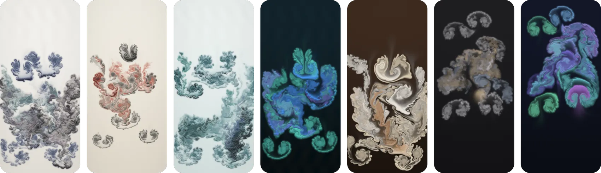

<p align="center">
  
</p>

<h1 align="center">Inkwell</h1>

Inkwell is an Android live wallpaper that simulates ink dropped into liquid. Touch the screen to add ink, drag to stir it, or leave it alone and new drops arrive on their own.

The fluid is a real-time simulation running on the GPU, so the motion is computed, not played back from a video.

<p align="center">
  
</p>

## Features

- Tap for a single drop, hold for a thin steady thread, drag to stir the liquid without adding ink.
- Six ink forms: Swirl, Bloom, Ring, Burst, Thread, Mist.
- Eleven styles: Porcelain, Sumi, Tide, Abyss, Crema, Incense, Aurora, Blush, Ember, Orchid, Moonstone.
- Tuning per style: weight, swirl, linger, drop size, flow, light, glow, caustics.
- Optional drifting drops, and a new drop each time the screen wakes.
- Optional motion effects, both off by default: tilt the phone and the ink flows downhill, shake it to stir the liquid.
- Save the current frame as a full-resolution PNG to the gallery.
- No network access, accounts, ads or analytics.

<p align="center">
  
</p>

## Requirements

- Android 8.0 (API 26) or newer
- A GPU that can render to half-float textures (OpenGL ES 3.0, or ES 2.0 with `EXT_color_buffer_half_float`)

Devices that cannot render the simulation show a message in the app and cannot set the wallpaper.

## Build

Requires JDK 17 and the Android SDK (compile SDK 37).

```
./gradlew assembleDebug
```

The APK is written to `app/build/outputs/apk/debug/`.

Install it and open the app, then use **Set as wallpaper**.

## Project layout

```
app/src/main/java/com/kodalibhargav/inkwell/
  InkSim.kt              fluid simulation and shaders (OpenGL ES)
  InkStyles.kt           styles, ink forms and persisted settings
  InkWallpaperService.kt wallpaper engine and EGL render thread
  MainActivity.kt        settings screen with live preview (Compose)
  InkCapture.kt          saving frames to the gallery
  MotionSource.kt        accelerometer input for tilt and shake
docs/                    store listing, privacy policy, release notes
```

## How it works

The simulation follows the stable-fluids method. Each frame the velocity field is advected, given buoyancy from the ink density, vorticity-confined, made divergence-free with a pressure solve, and then used to advect the dye. Dye is stored in a texture with colour in the RGB channels and density in alpha, so heavy ink sinks and light ink rises according to the style.

The display shader turns the dye into the final image. Styles use one of three modes: ink darkens a pale liquid, ink glows in a dark liquid, or pale ink clouds a dark liquid.

Tilt and shake use the accelerometer. A slow low-pass filter separates gravity from sudden movement. Gravity gives the downhill direction on the screen, which is added as a force on the ink, so tilting the phone makes the dye flow toward the lower side. What remains after the filter is the shake: when it passes a threshold, a few strong velocity impulses and new drops are added. The sensor is registered only while the wallpaper is visible and at least one of the two options is on.

The wallpaper engine runs its own EGL context on a render thread. Rendering pauses when the wallpaper is not visible and drops to a lower frame rate once nothing has been touched for a few seconds.

## Notes

- Touch input on the home screen depends on the launcher forwarding touch events to the wallpaper. Some launchers do not forward holds or drags.
- The application ID is `com.kodalibhargav.inkwell`.
- Privacy policy: [docs/privacy-policy.md](docs/privacy-policy.md)

## License

MIT. See [LICENSE](LICENSE).
