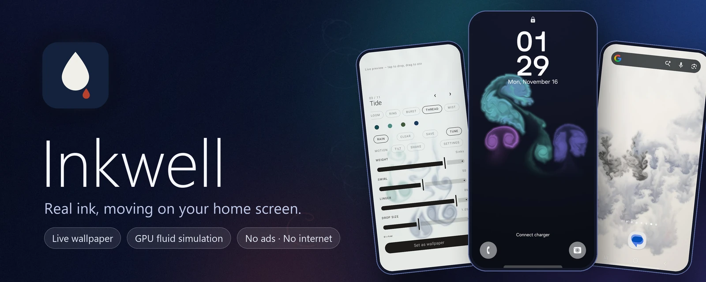
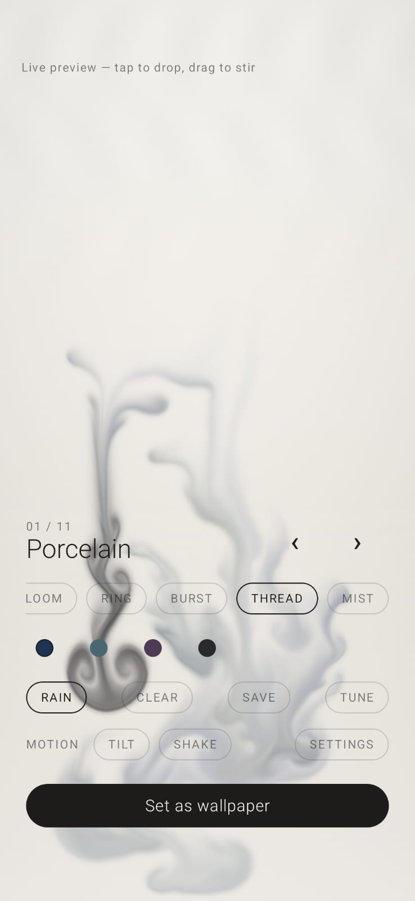
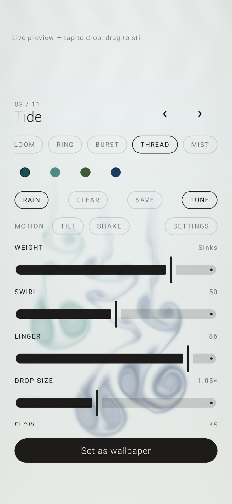
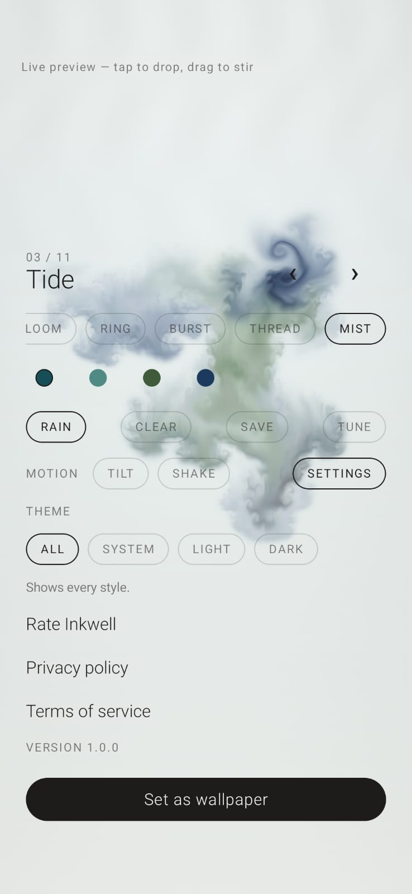
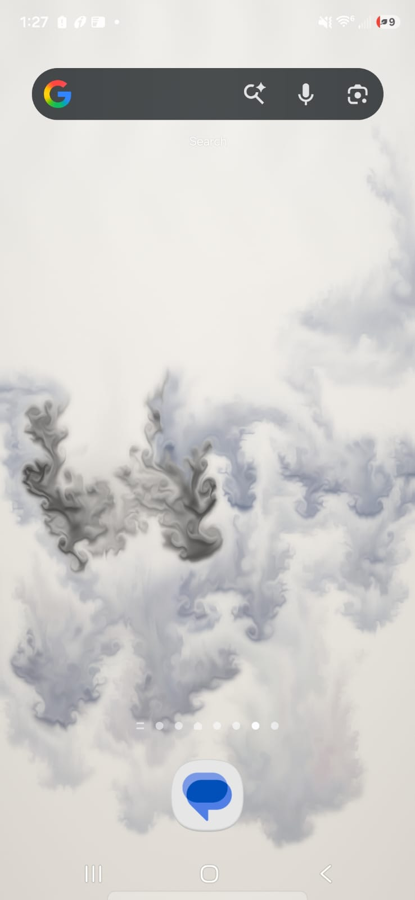
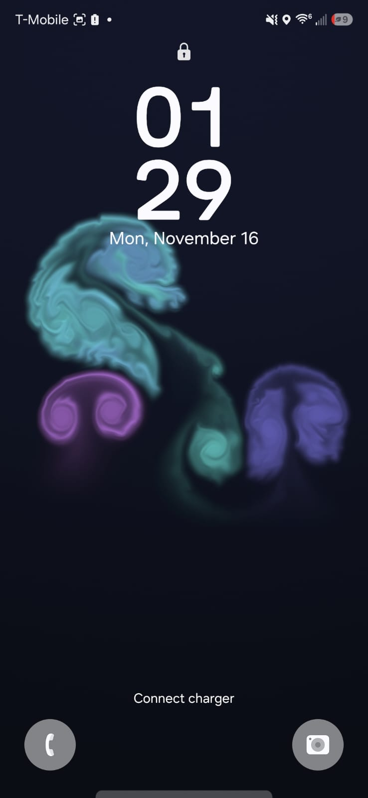

<p align="center">
  
</p>

<h1 align="center">Inkwell</h1>

<p align="center">
  <b>Real ink, moving on your home screen.</b><br>
  An Android live wallpaper that simulates ink dropped into liquid, computed live on your GPU.
</p>

<p align="center">
  <a href="https://github.com/kb019/InkWell/releases/latest"></a>
  <a href="LICENSE"></a>
  
  
  
</p>

<p align="center">
  <a href="https://play.google.com/store/apps/details?id=com.kodalibhargav.inkwell"></a>
  <a href="https://www.openapk.net/inkwell/com.kodalibhargav.inkwell/"></a>
  <a href="https://github.com/kb019/InkWell/releases/latest"></a>
</p>

<p align="center">
  
</p>

## Screenshots

<table align="center">
  <tr>
    <td align="center"></td>
    <td align="center"></td>
    <td align="center"></td>
    <td align="center"></td>
    <td align="center"></td>
  </tr>
  <tr>
    <td align="center"><sub><b>Porcelain</b></sub></td>
    <td align="center"><sub><b>Tide, tuning</b></sub></td>
    <td align="center"><sub><b>Settings</b></sub></td>
    <td align="center"><sub><b>Home screen</b></sub></td>
    <td align="center"><sub><b>Lock screen</b></sub></td>
  </tr>
</table>

## Features

**Play with it**
- **Touch it.** Tap for a single drop, hold for a thin steady thread, drag to stir the liquid without adding ink.
- **Six ink forms.** Swirl, Bloom, Ring, Burst, Thread, Mist.
- **Alive on its own.** New drops drift in by themselves, and a fresh drop falls each time the screen wakes.
- **Motion.** Optionally tilt the phone so the ink flows downhill, or shake it to stir (both off by default).

**Make it yours**
- **Eleven styles.** Porcelain, Sumi, Tide, Abyss, Crema, Incense, Aurora, Blush, Ember, Orchid, Moonstone. Pale liquids that ink darkens, dark liquids where ink glows, and creamy clouds in coffee-dark water.
- **Tune every style.** Weight, swirl, linger, drop size, flow, light, glow and caustics, plus ink strength and liquid tint.
- **Theme setting.** Show every style, follow the phone's light or dark mode, or use only pale or only dark liquids.
- **Save a frame.** Export the current picture as a full-resolution PNG.

**Respectful by design**
- No ads, accounts, analytics or trackers, and no `INTERNET` permission at all.
- Rendering pauses when the wallpaper isn't visible and slows down once the liquid settles.
- Privacy policy and terms are readable offline inside the app.

## Install

Inkwell is available from:

- [**Google Play**](https://play.google.com/store/apps/details?id=com.kodalibhargav.inkwell)
- [**OpenAPK**](https://www.openapk.net/inkwell/com.kodalibhargav.inkwell/)
- [**GitHub Releases**](https://github.com/kb019/InkWell/releases/latest): signed APK, checkable against `SHA256SUMS.txt`

After installing, launch Inkwell and tap **Set as wallpaper**.

**Requirements:** Android 8.0 (API 26) or newer, and a GPU that can render to half-float textures (OpenGL ES 3.0, or ES 2.0 with `EXT_color_buffer_half_float`). Devices that can't run the simulation show a message and can't set the wallpaper.

## Build from source

You need JDK 17 or newer and the Android SDK (compile SDK 37).

```bash
git clone https://github.com/kb019/InkWell.git
cd InkWell
./gradlew assembleDebug
```

The APK is written to `app/build/outputs/apk/debug/`. Check formatting with `./gradlew spotlessCheck` and fix it with `./gradlew spotlessApply`.

## How it works

The simulation follows the stable-fluids method. Each frame the velocity field is advected, given buoyancy from the ink density, vorticity-confined, made divergence-free with a pressure solve, and then used to advect the dye. Dye lives in a texture with colour in RGB and density in alpha, so heavy ink sinks and light ink rises according to the style. A display shader turns the dye into the final image, in one of three modes: ink darkens a pale liquid, ink glows in a dark liquid, or pale ink clouds a dark liquid.

The wallpaper engine runs its own EGL context on a render thread. Tilt and shake use the accelerometer: a slow low-pass filter splits gravity (which pushes the ink downhill) from sudden movement (which triggers a stir when it passes a threshold). The sensor is only registered while the wallpaper is visible and one of the two options is on.

<details>
<summary><b>Project layout</b></summary>

```
app/src/main/java/com/kodalibhargav/inkwell/
  InkSim.kt              fluid simulation and shaders (OpenGL ES)
  InkStyles.kt           styles, ink forms and persisted settings
  InkWallpaperService.kt wallpaper engine and EGL render thread
  MainActivity.kt        settings screen with live preview (Compose)
  InkCapture.kt          saving frames to the gallery
  MotionSource.kt        accelerometer input for tilt and shake
  LegalText.kt           privacy policy and terms shown in Settings
docs/                    privacy policy and terms of service
fastlane/                store metadata and screenshots
```

</details>

## Notes

- Touch on the home screen depends on the launcher forwarding touch events to the wallpaper. Some launchers don't forward holds or drags.
- The application ID is `com.kodalibhargav.inkwell`.
- [Privacy policy](docs/privacy-policy.md) · [Terms of service](docs/terms-of-service.md)

## Contributing

Issues and pull requests are welcome. Commit messages and PR titles follow [Conventional Commits](https://www.conventionalcommits.org/) (`feat:`, `fix:`, `docs:`, ...), because releases are generated from them. Code is formatted with ktlint through Spotless: run `./gradlew spotlessApply` before committing. CI checks both on every pull request.

## License

[MIT](LICENSE). The fluid solver is derived from [WebGL Fluid Simulation](https://github.com/PavelDoGreat/WebGL-Fluid-Simulation) by Pavel Dobryakov (MIT). See [THIRD_PARTY_NOTICES.md](THIRD_PARTY_NOTICES.md).
